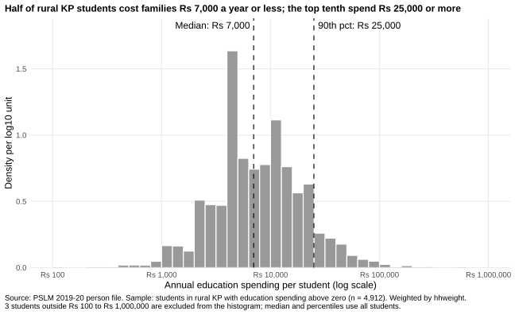
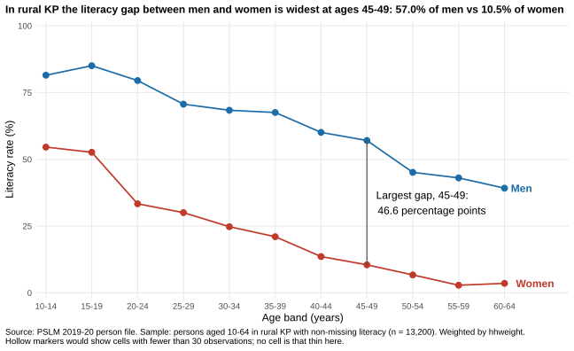
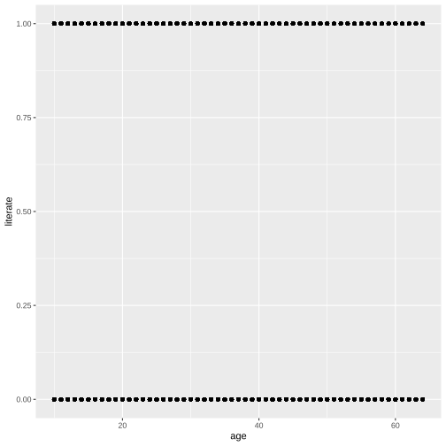
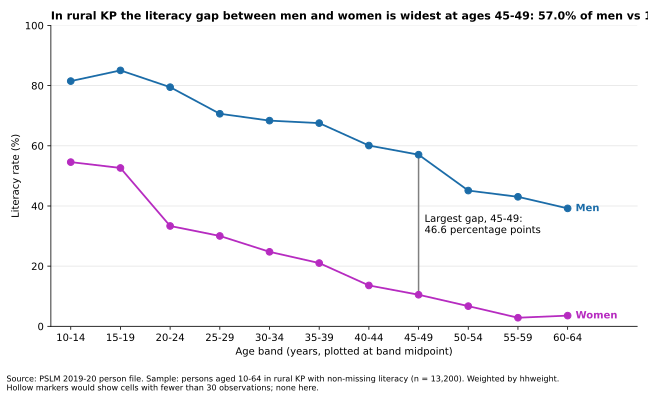

# ECO346 Assignment 1: Education spending and literacy in rural Khyber Pakhtunkhwa

**Course:** Data Visualization Techniques for Economists (ECO346), COMSATS University Islamabad, Lahore Campus, Fall 2026
**Student:** Abdul Muqeet | **Registration no.:** FA24-BEDS-004 | **Section:** B

## Variant

Registration number ends in 04, and 4 = 0 × 8 + 4, so my **variant is 4: Khyber Pakhtunkhwa (KP), rural** (`prov_code == 1`, `urban_rural == 1`).

Data: PSLM 2019-20. The person file has no weight, province or area, so `hhweight`, `prov_code` and `urban_rural` are attached from the household file by `hhid`. Every statistic is weighted by `hhweight`.

| Sample | Definition | Size |
|---|---|---|
| Persons in variant | Rural KP | 19,896 |
| Literacy sample | Age 10-64, `literate` not missing | 13,200 |
| Students | `ed_total > 0` | 4,912 |

## Repository structure

```
README.md
data/       pslm_person_subset.csv, pslm_hh_subset.csv
scripts/    00_prep.R            builds the samples (sourced by the R scripts)
            01_default.R         default figure (Q4)
            02_distribution.R    spending histogram (Q2)
            03_literacy.R        literacy figure and band table (Q3, Q4 redesign)
            05_literacy.py       same table and figure in Python (Q5)
figures/    default.svg, distribution.svg, literacy.svg,
            literacy_python.svg, band_table.csv, band_table_python.csv
slides/     FA24-BEDS-004.pptx
```

## How to reproduce

A fresh clone needs no internet and no manual step. From the repository root:

```
Rscript scripts/01_default.R
Rscript scripts/02_distribution.R
Rscript scripts/03_literacy.R
python scripts/05_literacy.py
```

Requirements: R with `tidyverse` and `svglite`; Python with `pandas` and `matplotlib`. All scripts read the local copies in `data/` with relative paths, and every figure is saved as SVG by the script that draws it.

---

## Q2. The distribution



Weighted histogram of annual education spending per student, on a log10 scale, with bins 0.1 wide from 2.0 to 6.0 (Rs 100 to Rs 1,000,000). The vertical axis is density per log10 unit. Dashed lines mark the weighted median and weighted 90th percentile. Quantiles use the assignment's definition (smallest value at which the cumulative weight share reaches p), not R's `quantile()`. The median and percentiles use all 4,912 students; only the histogram excludes students outside Rs 100 to Rs 1,000,000.

| Statistic | Value |
|---|---|
| Number of students | 4,912 |
| Weighted median | Rs 7,000 |
| Unweighted median | Rs 7,000 |
| Weighted 10th percentile | Rs 2,500 |
| Weighted 90th percentile | Rs 25,000 |
| Ratio p90 / p10 | 10.00 |
| Students excluded from histogram | 3 |

**Interpretation.** Spending is right-skewed on the log scale: the typical rural KP student costs Rs 7,000 a year, while the 90th percentile is Rs 25,000, ten times the 10th percentile (Rs 2,500). Weighted and unweighted medians are both Rs 7,000 because families report round amounts, so many students share the same value and the median sits on it whichever weights are used. Three students outside Rs 100 to Rs 1,000,000 are excluded from the histogram.

---

## Q3. The relationship



Weighted literacy rate (%) by five-year age band, plotted at band midpoints (12, 17, ..., 62), for women and men. Cells with fewer than 30 observations would get hollow markers; **no cell is that thin** (the smallest is 190, women aged 60-64), so all markers are filled.

### Band table

| Band | Women: persons | Women: literacy rate (%) | Men: persons | Men: literacy rate (%) |
|---|---:|---:|---:|---:|
| 10-14 | 1,210 | 54.6 | 1,439 | 81.5 |
| 15-19 | 985 | 52.6 | 1,162 | 85.1 |
| 20-24 | 906 | 33.3 | 768 | 79.5 |
| 25-29 | 826 | 30.0 | 580 | 70.6 |
| 30-34 | 588 | 24.8 | 499 | 68.4 |
| 35-39 | 546 | 21.0 | 421 | 67.5 |
| 40-44 | 449 | 13.6 | 357 | 60.1 |
| 45-49 | 392 | 10.5 | 385 | 57.0 |
| 50-54 | 384 | 6.7 | 278 | 45.1 |
| 55-59 | 308 | 2.9 | 255 | 43.0 |
| 60-64 | 190 | 3.6 | 272 | 39.2 |

### Key numbers

| Item | Women | Men |
|---|---:|---:|
| Aged 15-19 | 52.6% | 85.1% |
| Aged 55-59 | 2.9% | 43.0% |

**Largest gap:** ages 45-49, where 57.0% of men and 10.5% of women are literate, a gap of 46.6 percentage points.

**Interpretation.** Literacy in rural KP is higher among younger cohorts for both sexes, but women trail men at every age. Among 55-59 year-olds, 2.9% of women and 43.0% of men are literate; at 15-19 the rates are 52.6% and 85.1%. The gap is widest at 45-49 (46.6 points) and has narrowed among the young, though not closed. An economist would read this as expanding schooling access across cohorts, with girls still behind, which limits women's returns to education. It cannot tell us whether individuals lose literacy with age or whether older cohorts simply never attended school: this is one cross-section, so age and cohort effects are mixed.

---

## Q4. The makeover

| Default (`figures/default.svg`) | Redesign (`figures/literacy.svg`) |
|---|---|
|  |  |

The default is `ggplot(lit, aes(age, literate)) + geom_point()` with nothing added. It was committed before the redesign.

**Explanation of the redesign.** The default plots 13,200 individual 0/1 points, which stack into two solid rows: overplotting hides how many people sit at each age and shows no trend. I made three changes. First, I plotted weighted conditional means (literacy rate by age band), which turns a binary outcome into a readable quantity. Second, I put the rate on a common 0-100 vertical scale, the most accurately perceived channel in the perceptual ranking of channels, and drew women and men as separate lines. Third, I labeled the lines directly and removed the legend and clutter, raising the data-ink ratio. The default shows individual observations and single-year ages; my redesign hides them inside five-year bands.

---

## Q5. A second language (Python)



`scripts/05_literacy.py` recomputes the band table and redraws the Q3 figure with pandas and matplotlib. The two band tables (`figures/band_table.csv` from R, `figures/band_table_python.csv` from Python) have identical counts and agree on every rate to one decimal (maximum difference 0.0).

| Item | R | Python |
|---|---:|---:|
| Literacy rate, women aged 15-19 | 52.6% | 52.6% |

**Default that differed.** Matplotlib pads the axes by default, so the y-axis ran past 0-100 and the plot did not match the R figure. I set `ylim(0, 100)` and an explicit `xlim`, and placed ticks at the band midpoints, so both figures use the same axes. The band tables then matched exactly.

---

## Data source

PSLM 2019-20, Pakistan Bureau of Statistics (person and household files, course subset from `github.com/rafi-amiruddin/DVTE`).